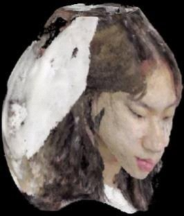

<!-- portfolio-cover-v1 -->
# NeuralDynaRender

**NeRF · PBD · CUDA Parallel Resampling**

    

2024 · 캡스톤 4인 팀 · 공저 논문

[**Portfolio ↗**](https://soz1p.github.io/jeon-sojin-portfolio/#projects)

NeRF로 복원한 RGBA 볼륨과 물리엔진의 서로 다른 데이터 표현과 해상도를 연결해 변형 결과를 시각화합니다.

2024년 논문 Figure 1 · 팀 전체 파이프라인

## Highlights

| RGBA 볼륨 | 논문 당시 물리 격자 | 팀 구성 |
| :---: | :---: | :---: |
| 256³ | 64³ | 4인 |

**Pipeline:** NeRF volume → PBD deformation → CUDA resampling → Ray casting

## My Contributions

NeRF 볼륨과 PBD 결합, float4 기반 CUDA 3D 텍스처 샘플링, 병렬 리샘플링 및 렌더링 연동. NeRF 학습 엔진 자체의 개발은 담당 범위가 아닙니다.

## Approach

- NeRF의 4채널 RGBA 볼륨과 PBD 물리 격자의 데이터 표현을 연결합니다.
- 물리 격자의 변위 정보를 보간하여 고해상도 볼륨의 변형에 반영합니다.
- CUDA 3D 텍스처를 이용해 RGBA 값을 병렬 리샘플링합니다.
- 변형된 볼륨을 광선 투사 방식으로 시각화합니다.

  

2024년 논문 Figure 7 · 수식 기반 변형 결과

## Publication

**NeRF, PBD 및 병렬 리샘플링을 결합한 실시간 3D 볼륨 변형체 시각화**  
권상민 · 전소진 · 박준이 · 김다솔 · 계희원  
한국컴퓨터그래픽스학회 논문지 30(3), 189–198, 2024.

[KCI · Published paper](https://www.kci.go.kr/kciportal/landing/article.kci?arti_id=ART003103457)

## Source Availability

공동 연구 및 연구실 소스코드, 촬영 원본 데이터는 공개하지 않습니다. 기반 기술은 NVIDIA instant-ngp이며, 이 페이지는 팀 프로젝트와 개인 기여를 소개합니다.

## Materials

공저 논문의 원문은 위 KCI 공식 페이지에서 확인할 수 있습니다. PDF 재배포 조건이 확인되지 않아 저장소에 복제하지 않습니다. 파이프라인은 논문 Figure 1, 변형 결과는 Figure 7이며 팀 전체 결과와 개인 담당 범위를 구분합니다.
