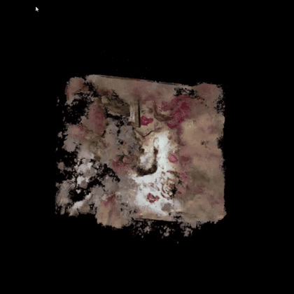
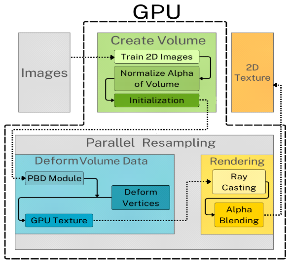
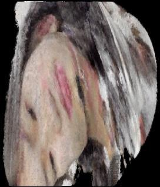
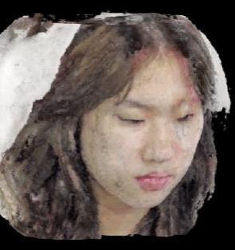

<picture>
  <source media="(prefers-color-scheme: dark)" srcset="images/header-dark.svg">
  
</picture>

<p align="center">
  <a href="https://soz1p.github.io/jeon-sojin-portfolio/#p-ndr"><b>Portfolio (KO)</b></a> &nbsp;·&nbsp; <a href="https://soz1p.github.io/jeon-sojin-portfolio/?lang=en#p-ndr"><b>Portfolio (EN)</b></a> &nbsp;·&nbsp; <a href="https://www.kci.go.kr/kciportal/landing/article.kci?arti_id=ART003103457"><b>KCI paper</b></a>
</p>

<p align="center">
       
</p>

> **핵심 기여** &nbsp; NeRF 볼륨과 PBD 물리엔진을 잇는 CUDA 병렬 리샘플링을 맡아, 캡스톤디자인 장려상과 학술지 공저 논문 게재에 기여했습니다.

<p align="center"></p>
<p align="center"><sub>결과 화면 · NeRF로 복원한 여우 장면의 RGBA 볼륨을 PBD로 변형하고, 병렬 리샘플링과 광선 투사로 렌더링</sub></p>

## At a glance

| 4인 | 256³ | 64³ | 2024.05 |
| :---: | :---: | :---: | :---: |
| 캡스톤 팀 | RGBA 볼륨 해상도 | PBD 물리 격자 | 캡스톤디자인 장려상 |

**Pipeline** &nbsp; Smartphone video → NeRF RGBA volume → PBD deformation (64³) → CUDA parallel resampling (256³) → Ray casting

## STAR

| | |
| :-- | :-- |
| **S** · 상황 | 스마트폰 영상으로 복원한 NeRF 데이터에 움직임을 주려 했지만, 기존 물리엔진은 단일 채널 CT 데이터만 처리하도록 되어 있었습니다. |
| **T** · 과제 | 4인 팀에서 RGBA 볼륨을 물리엔진과 렌더러에 연결하고, 변형 후에도 색과 불투명도를 유지하는 역할을 맡았습니다. |
| **A** · 내가 한 일 | • 기존 단일 채널 처리·렌더링 구조를 분석했습니다.<br>• CUDA 3D 텍스처 샘플링을 float4 기반으로 확장해 RGBA 네 채널을 함께 처리했습니다.<br>• 64³ 물리 격자의 변위를 256³ 볼륨에 반영하는 병렬 리샘플링을 구현했습니다.<br>• 변형된 볼륨을 렌더링 파이프라인에 연결하고, 팀원이 맡은 NeRF 복원·물리 시뮬레이션과 연동했습니다. |
| **R** · 결과 | 데이터 표현과 해상도가 서로 다른 NeRF, PBD, 볼륨 렌더링을 하나의 변형·가시화 파이프라인으로 묶었고, 캡스톤디자인 장려상(2024.05)과 2024 한국컴퓨터그래픽스학회 논문 게재로 이어졌습니다.<br><sub>NeRF 모델 학습은 팀 담당이며, 개인 기여는 데이터 연동과 GPU 리샘플링입니다.</sub> |

## How it works

<p align="center"></p>
<p align="center"><sub>게재 논문 Figure 1 · 단일 채널 변형 파이프라인을 RGBA로 확장해, 해상도가 다른 물리 계산과 렌더링을 하나로 연결</sub></p>

### 병렬 리샘플링: 변형된 사면체 안을 다시 채우기 &nbsp;<sub>`직접 구현`</sub>

물리 계산은 64³에서 하고 화면은 256³으로 그리기 때문에, 성긴 변형 결과로 고해상도 볼륨을 다시 만들어야 합니다. 볼륨을 작은 사면체로 쪼개 모든 사면체를 GPU에서 동시에 처리했습니다.

1. **5T 분해** · 인접한 8개 복셀을 하나의 셀로 묶어 255³개 육면체를 만들고, 셀마다 5개의 사면체로 나눕니다.
2. **변형 추정** · PBD 결과의 이동 벡터를 보간해 각 사면체 꼭짓점의 이동량을 구합니다.
3. **후보 복셀** · 변형된 사면체마다 축 정렬 경계 상자 안의 복셀을 후보로 고릅니다.
4. **보간** · 무게중심 좌표로 원래 위치를 찾아 색과 밀도를 선형 보간합니다. 기존 16-bit 단일 채널 대신 **float4 RGBA**를 다루도록 텍스처 샘플링을 바꿨습니다.

| 식 | 의미 |
| --- | --- |
| `λ = M′⁻¹ (x − v₀′)` | 변형 사면체의 무게중심 좌표 |
| `x₀ = Σ λₖ vₖ` | 원래 볼륨 위치로 역매핑 |
| `RGBA(x) = tex3D(x₀)` | 하드웨어 삼선형 보간 |
| `α = 1 − e^(−τ)` | NeRF 밀도 τ를 불투명도로 |

```text
# 데이터 흐름 설명용 의사코드 (연구실 구현은 비공개)
원본 위치  ← 변형 사면체의 보간으로 계산
RGBA      ← 원본 볼륨을 float4 3D 텍스처로 삼선형 샘플링
출력 복셀  ← 색상 3채널과 불투명도를 함께 저장
```

### 팀 전체 파이프라인

- **NeRF 밀도 보정** · 볼륨 중심 타원체 바깥 복셀을 0으로 만들고, 임곗값(5 / 20 / 35 비교 후 20 채택)보다 낮은 밀도를 투명하게 처리했습니다.
- **밀도 정규화와 렌더링** · `α = 1 − e^(−τ)`로 0~1 불투명도로 바꾸고, 광선 투사와 알파 블렌딩으로 그립니다. 누적 불투명도가 0.99를 넘으면 광선을 조기 종료합니다.
- **강성 값** · NeRF는 표면 밀도만 학습되어 내부 밀도가 부정확하므로, 64³ 변형체의 강성을 1.0으로 고정했습니다.
- **수식 기반 변형 모드** · PBD 외에 Wave, Twist, Bubble 수식 변형을 같은 파이프라인에 넣었습니다.

<p align="center">  </p>
<p align="center"><sub>게재 논문 Figure 7 · Wave / Twist / Bubble</sub></p>

## Results

| 항목 | 값 |
| --- | --- |
| 볼륨 | 256 × 256 × 256 · 4채널 · 256 MB |
| 512³ 볼륨(2 GB) 대비 | 변형 시간 약 43배, 렌더링 시간 약 26배 증가 → 256³ 채택 |
| GPU 텍스처 복사 | 약 1 ms (≈700 GB/s) |
| 학습 데이터 | iPhone 14 Pro 1분 20초 촬영, Instant-NGP 2,500~3,000 스텝 |

<sub>게재 논문 Table 1 및 본문 · AMD Ryzen 9 3900X, 64 GB, NVIDIA GeForce RTX 3090</sub>

## Limitations & next steps

- 새 시점 영상을 학습 루프 없이 바로 변형하므로 화질이 떨어지는 한계가 있습니다.
- 노이즈 제거가 타원체 마스크와 고정 임곗값에 의존합니다. 데이터별 자동 제거가 다음 과제입니다.
- 강성을 사람이 정했습니다. 볼륨 특성에서 강성을 자동으로 정하는 방법을 연구할 수 있습니다.

## Publication

**NeRF, PBD 및 병렬 리샘플링을 결합한 실시간 3D 볼륨 변형체 시각화**
권상민 · 전소진 · 박준이 · 김다솔 · 계희원
한국컴퓨터그래픽스학회 논문지 30(3), 189–198, 2024 · [KCI](https://www.kci.go.kr/kciportal/landing/article.kci?arti_id=ART003103457)

한성대학교 캡스톤디자인 장려상 (2024.05.31)

## Source availability

공동 연구 및 연구실 소스코드, 촬영 원본 데이터는 공개하지 않습니다. 기반 기술은 NVIDIA instant-ngp입니다.

---

<sub>전소진 · Jeon Sojin · Graphics Engineer &nbsp;|&nbsp; <a href="https://soz1p.github.io/jeon-sojin-portfolio/">Portfolio</a> · <a href="https://github.com/soz1p">GitHub</a> · <a href="https://www.linkedin.com/in/soz1p">LinkedIn</a> · jeonsoz1p@gmail.com</sub>
